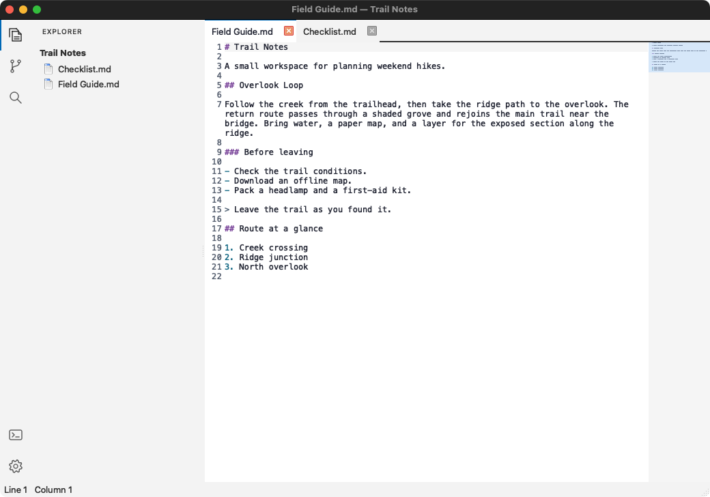
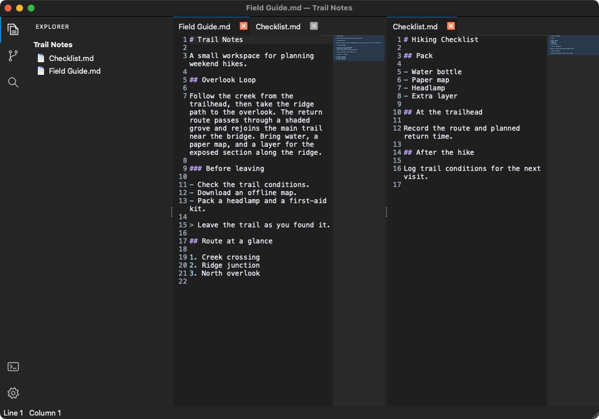

# Nebula Code

Nebula Code is an offline-first Qt Widgets editor for macOS (Intel and Apple Silicon) and Linux (x86-64 and ARM64). Each window contains a folder explorer, tabbed Scintilla editors, and an optional interactive terminal. A split shares its document and undo history with the original view. Each view keeps its own cursor and scroll position.

Nebula Code has a small memory footprint. In the Linux benchmarks below, its process tree used a median of **35–70 MiB** across two file sizes and two architectures, about **94–97% less memory than VS Code** in the same runs.

## Screenshots





## Build and run

Use a C++20 compiler, CMake 3.25 or newer, Ninja, and Qt 6.5 or newer with Widgets, Core5Compat, and Test. The Release preset uses the host architecture. Use an empty build directory when switching compilers or architectures.

### macOS

Install the Apple Command Line Tools and a Qt installation that matches your Mac's architecture.
Use Qt 6.12.1 or newer for macOS builds to include the fix for an
[accessibility crash in the Cocoa platform plugin](https://qt-project.atlassian.net/browse/QTBUG-149612).

```sh
cmake --preset release
cmake --build --preset release --parallel 4
ctest --preset release
open build/release/NebulaCode.app
```

Open a specific workspace or file directly from a shell.

```sh
build/release/NebulaCode.app/Contents/MacOS/NebulaCode /path/to/project
```

### Linux

On Ubuntu 26.04, install the build dependencies and then build, test, and launch Nebula.

```sh
sudo apt install build-essential cmake ninja-build qt6-base-dev qt6-5compat-dev clangd
cmake --preset release
cmake --build --preset release --parallel 4
QT_QPA_PLATFORM=offscreen ctest --preset release
build/release/NebulaCode /path/to/project
```

To add Nebula to the desktop application menu, install it under a prefix whose `bin` directory is in your desktop session's `PATH`. The standard system prefix is `/usr/local`.

```sh
sudo cmake --install build/release --prefix /usr/local
```

### Offline builds

The first configure downloads Scintilla 5.6.9, Lexilla 5.5.5, and QTermWidget 2.4.0. To build offline, supply copies of the pinned upstream archives. CMake checks their SHA-256 digests.

```sh
cmake --preset release \
  -DNEBULA_SCINTILLA_URL=/absolute/path/scintilla569.tgz \
  -DNEBULA_LEXILLA_URL=/absolute/path/lexilla555.tgz \
  -DNEBULA_QTERMWIDGET_URL=/absolute/path/qtermwidget-2.4.0.tar.xz
cmake --build --preset release --parallel 4
```

## Install from GitHub

Choose the package for your machine from [GitHub Releases](https://github.com/saikrishna488/nebula-code/releases).

| Platform | Download |
| --- | --- |
| macOS, Apple Silicon | `*-macos-arm64.zip` |
| macOS, Intel | `*-macos-x86_64.zip` |
| Ubuntu 26.04, x86-64 | `nebula-code_*_amd64.deb` |
| Ubuntu 26.04, ARM64 | `nebula-code_*_arm64.deb` |

On macOS, unzip the download and move `NebulaCode.app` to Applications. The app is ad hoc signed, so macOS Gatekeeper can block a downloaded copy. On Ubuntu, run `sudo apt install ./<downloaded-file>.deb`.

Publish a GitHub Release from a tag that contains the workflow. Actions builds and tests all four targets before attaching their packages and the corresponding macOS source archives. To build packages without publishing a release, run **Build and test** manually in the Actions tab and download the packages from the run's artifacts.

## Package for macOS

Use Python 3.11 or newer and the Homebrew Qt toolchain from the Release build. Put the three pinned editor dependency archives in `build/vendor`. The packager also reads the corresponding Homebrew source archives and patches from the Homebrew download cache and `build/vendor`.

```sh
python3 scripts/package-macos.py
open build/dist/NebulaCode.app
```

`build/dist` contains the ad hoc signed app, its architecture-specific ZIP, and the corresponding source archive. Choose the ZIP that matches your Mac (`x86_64` for Intel or `arm64` for Apple Silicon), unzip it, and move `NebulaCode.app` into Applications. The app includes dependency notices in `Contents/Resources/Notices`. The source archive includes Nebula's build files, pinned upstream archives, and the installed Homebrew recipes and patches.

## Editing

Use **File → Open Folder** or **Open Recent Folder** to switch workspaces in the current window. Nebula prompts for unsaved edits and restores the selected folder’s tabs and splits. Use **⌘P** for Quick Open to jump to any workspace file, **Ctrl+G** for Go to Line (`line` or `line:column`), and **⌘⇧F** for Find in Files. Use the left activity bar to switch between Explorer and Source Control, find text in the current document, open the terminal, or open Settings. The **View** menu controls the split, minimap, terminal, theme, and source control panel. Search commands by name with **⌘⇧P**. **⌘D** selects the next occurrence for simultaneous editing. **⌘F** opens find and replace with Match Case and Whole Word options.

Right-click a tab to choose **Split Left**, **Split Right**, **Move to New Window**, or **Close Tab**. Moving a tab keeps its unsaved edits, undo history, and split views.

**View → Text Wrap** is enabled by default and wraps long lines to fit the editor width. Changes to this preference apply to open windows and persist across restarts.

Files use UTF-8. Saving preserves existing BOMs and line endings, checks for changes since the file was loaded, and atomically replaces the target. **File → Reload from Disk** reads the latest contents. Closing a modified tab offers to save or discard its edits. The main workspace window records its file tabs, active document, split sizes, and cursor positions for the next session.

Open or save Markdown documents with the `.md` or `.markdown` extension for highlighting of headings, emphasis, links, lists, quotes, and code. Nebula also highlights C/C++, Python, JSON, Bash/Zsh, CMake, YAML, Rust, HTML/XML, CSS, and Diff/Patch files.

The terminal opens in the workspace directory and docks at the bottom by default. Use the terminal title-bar menu to dock it at the top, right, bottom, or left. Nebula remembers the workspace's dock position. Drag the divider to resize. Hiding the panel keeps the session alive. Closing the panel or exiting its shell ends the session. The terminal retains up to 5,000 lines of history.

## C/C++ and Git

Install clangd through the Apple Command Line Tools or set the path to another local clangd executable in the settings. Opening a supported C/C++ file in a workspace starts the language server on demand. Generate a compilation database for accurate project-specific results.

```sh
cmake -S . -B build -G Ninja -DCMAKE_EXPORT_COMPILE_COMMANDS=ON
```

Place or link the resulting `compile_commands.json` at the project root, or configure its directory through the project's `.clangd`. Use the **Tools** menu for completion, definition, references, and language-server restart. **View → Toggle Language Results** opens diagnostics and navigation results. Files over 2 MiB skip clangd synchronization at open. Files over 8 MiB also skip syntax highlighting and folding at load.

The source control panel uses the local `git` executable. Open a repository folder, select a path, and choose its staged or unstaged diff. Stage or unstage the selected path, enter a message, and commit. Configure your Git author name and email before the first commit. Branch and remote operations are available through the terminal.

## Local preferences

Open the gear in the lower-left corner or press **⌘,** for Appearance Settings. Choose Light or Dark and adjust sidebar and editor colors, editor font and size, and minimap visibility. Save applies the changes to open windows and keeps them for the next launch. New configurations start in Light.

Nebula uses Qt's application configuration directory. Set `NEBULA_CONFIG_DIR` to choose an explicit directory. Settings, keybindings, named themes, and saved sessions are versioned JSON files. Restart the editor after editing settings and keyboard overrides.

**settings.json**

```json
{
  "version": 1,
  "theme": "dark",
  "minimap": true,
  "textWrap": true,
  "shell": "/bin/zsh",
  "clangd": "/usr/bin/clangd"
}
```

**keybindings.json**

```json
{
  "version": 1,
  "bindings": {
    "view.split": "Ctrl+Alt+S",
    "language.references": "Shift+F12"
  }
}
```

Binding strings use Qt portable notation. On macOS, `Ctrl` in this notation maps to Command. An empty string clears a command's shortcut. Command IDs are registered in [Workbench.cpp](src/app/Workbench.cpp).

To customize a theme, copy [dark.json](resources/themes/dark.json) or [light.json](resources/themes/light.json) into the configuration directory's `themes` folder under a new name. Edit the colors, font family, and point size, then select the filename in **View → Choose Theme**.

## Validation

The Release suite covers the editor, workbench and session restore, terminal PTY, local Git, and LSP. The LSP tests use both a fake server and a real clangd CMake fixture. Git and clangd must be installed for the corresponding integration checks to run. A smaller build can run workspace and settings tests with Qt Widgets and Test alone.

```sh
cmake --preset workspace-tests
cmake --build --preset workspace-tests
ctest --preset workspace-tests
```

Run `python3 scripts/benchmark.py` after a Release build to measure fresh launches, RSS, idle CPU, file opening, and key-to-paint latency on the current Mac.

On Linux, use the head-to-head benchmark with the VS Code GUI executable. Install `xvfb`, `xauth`, and `xdotool` to run it on a virtual X11 display. If Chromium restricts access to a sandbox process's memory counters, the benchmark uses noninteractive sudo to read that process's PSS.

```sh
xvfb-run -a --server-args="-screen 0 1280x800x24" python3 scripts/compare-editors.py \
  build/release/NebulaCode /usr/share/code/code
```

The script alternates editor order and uses a fresh profile for every launch, with user extensions disabled in VS Code. It reports time from process launch to the first visible window titled for the input file, and process-tree proportional set size (PSS) five seconds later. The JSON includes raw samples, versions, and the host. The timing measures window visibility and does not measure typing latency.

### Ubuntu 26.04 benchmarks

Median time to a visible document window over seven fresh launches per editor and file size. Both editors ran on the same GitHub-hosted runner for each architecture using Xvfb. Speedup is VS Code's median divided by Nebula's median. These results are from Nebula revision `6028b09`, before Text Wrap was added.

| Architecture | Plain-text file | Nebula 1.0.0 | VS Code 1.148.0 | Speedup |
| --- | ---: | ---: | ---: | ---: |
| x86-64 | 75 KB | 145 ms | 2.71 s | 18.7× |
| x86-64 | 11.25 MB | 259 ms | 2.70 s | 10.4× |
| ARM64 | 75 KB | 96 ms | 2.34 s | 24.4× |
| ARM64 | 11.25 MB | 199 ms | 2.31 s | 11.6× |

Median process-tree PSS five seconds after the document window became visible. PSS counts shared memory proportionally across processes.

| Architecture | Plain-text file | Nebula 1.0.0 | VS Code 1.148.0 |
| --- | ---: | ---: | ---: |
| x86-64 | 75 KB | 35.08 MiB | 1,109.26 MiB |
| x86-64 | 11.25 MB | 57.48 MiB | 1,194.06 MiB |
| ARM64 | 75 KB | 48.60 MiB | 1,136.56 MiB |
| ARM64 | 11.25 MB | 70.17 MiB | 1,188.78 MiB |

[GitHub Actions run and raw benchmark artifacts](https://github.com/saikrishna488/nebula-code/actions/runs/45656171484)

## License

Nebula Code is distributed under the GNU General Public License version 3. The dependency versions and archive hashes are in [Editor.cmake](cmake/Editor.cmake) and [Terminal.cmake](cmake/Terminal.cmake). Each library retains its upstream license. See [LICENSE](LICENSE).
